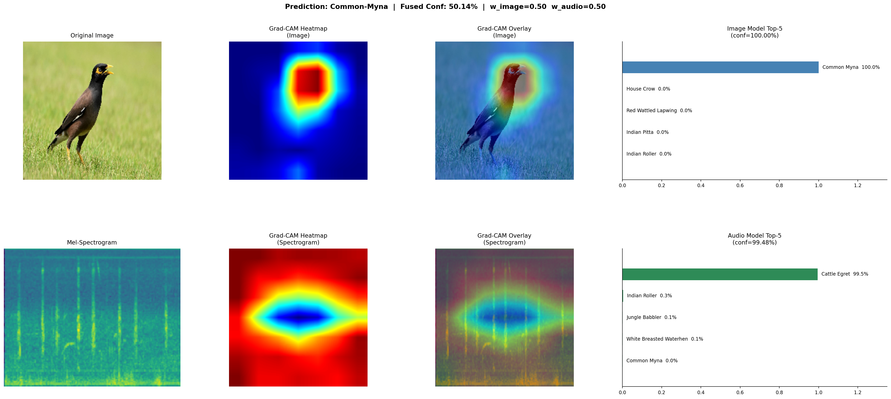
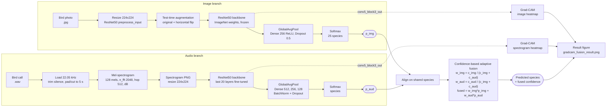

# Bird Species Classification: Image + Audio Fusion with Grad-CAM

A multimodal classifier for 25 bird species. It combines two ResNet50 transfer-learning models, one trained on **photos** and one on **mel-spectrograms of bird calls**. A confidence-based adaptive fusion step merges their predictions, and **Grad-CAM** heatmaps show what each model looked at.



*Output of `src/fusion.py`: image branch (top), audio branch (bottom), and the fused prediction in the title.*

## Architecture



## How it works

**Image model** (`train_resnet50.py`): ImageNet-pretrained ResNet50 (frozen) → GlobalAveragePooling → Dense(256) → Dropout(0.5) → softmax. Trained with augmentation (rotation, shifts, zoom, flip), Adam (1e-3), early stopping. At inference, `fusion.py` averages predictions over the original and a horizontally flipped image.

**Audio model** (`train_audio.py`): audio is trimmed, padded/cut to 5 s, and converted to a 128-band mel-spectrogram PNG. The same ResNet50 backbone is used with a deeper head (Dense 512/256/128 with BatchNorm and Dropout). Training runs in two phases:
1. frozen backbone (lr 1e-3)
2. fine-tuning the last 20 backbone layers (lr 1e-4)

Class weights compensate for class imbalance.

**Confidence-based adaptive fusion**: the two models' probabilities are aligned over the species they share, then combined with weights that adapt per sample to each model's top confidence, so the more certain modality counts for more:

```
w_img = c_img / (c_img + c_aud)
w_aud = c_aud / (c_img + c_aud)
fused = w_img * p_img + w_aud * p_aud
```

**Grad-CAM** is computed on the last ResNet50 conv block (`conv5_block3_out`) for both branches.

## Repository layout

```
.
├── src/
│   ├── audio_utils.py            # shared .wav → spectrogram code (used by training data prep AND inference)
│   ├── audio_to_spectrogram.py   # converts the audio train/valid folders to spectrogram .png files
│   ├── preprocess.py             # builds the image generators; prints class labels (sanity check)
│   ├── save_class_indices.py     # writes class_indices.json for the image model
│   ├── train_resnet50.py         # trains the image model → resnet50_birds25.h5
│   ├── train_audio.py            # trains the audio model → audio_model_best.h5
│   ├── predict.py                # evaluates image / audio / fusion accuracy on the validation sets
│   └── fusion.py                 # single image + audio inference with Grad-CAM visualisation
├── assets/                       # README images
├── requirements.txt
├── LICENSE
└── README.md
```

## Setup

Python 3.9–3.11 is recommended.

```bash
git clone https://github.com/nehash28/Multi-Modal-Bird-Species-Classification-Using-GRAD-CAM-Interpretability.git
cd Multi-Modal-Bird-Species-Classification-Using-GRAD-CAM-Interpretability
python -m venv .venv && source .venv/bin/activate   # Windows: .venv\Scripts\activate
pip install -r requirements.txt
```

## Data layout

The datasets are not included. Put them in the repository root with one sub-folder per species. Folder names must match between the image and audio sets.

```
train/                  valid/                  # images (.jpg/.jpeg/.png)
  Common-Myna/            Common-Myna/
  Cattle-Egret/           Cattle-Egret/
  ...                     ...

audio_train/            audio_valid/            # recordings (.wav)
  Common-Myna/            Common-Myna/
  ...                     ...
```

## Usage

All scripts use paths relative to the **repository root**, so run them from there.

```bash
# 1. Convert audio to spectrogram images
#    (audio_train → audio_train_spectrogram, audio_valid → audio_valid_spectrogram)
python src/audio_to_spectrogram.py

# 2. Save the image model's class → index mapping (class_indices.json)
python src/save_class_indices.py

# 3. Train the image model  → resnet50_birds25.h5
python src/train_resnet50.py

# 4. Train the audio model  → audio_model_best.h5, audio_class_indices.json
python src/train_audio.py

# 5. Evaluate image vs. audio vs. fusion on the validation sets
python src/predict.py

# 6. Run fusion on one image + one recording, with Grad-CAM
#    Edit IMAGE_PATH / AUDIO_PATH at the top of src/fusion.py first
python src/fusion.py          # saves gradcam_fusion_result.png
```

(`src/preprocess.py` only builds the generators and prints the class labels. It is a quick check that your folders are read correctly.)

Models and class-index files are written to the repository root and are git-ignored.

## Pretrained weights

Trained weights (`resnet50_birds25.h5`, ~96 MiB, and `audio_model_best.h5`) are not stored in the repository. Download them from the project's **Releases** page, or train your own with the steps above, and place them in the repository root before running `predict.py` or `fusion.py`. The matching `class_indices.json` and `audio_class_indices.json` are needed too.

## Known limitations

- **Confident-but-conflicting models.** Weights are proportional to each model's top softmax score. When both models are near 100% confident but disagree, the weights are about 0.5 / 0.5 and the winner is decided by a tiny margin (as in the example image above, where the fused result is ~50%). Calibrating the models or weighting by validation accuracy would make fusion more robust.
- **Validation pairing is positional.** `predict.py` pairs the *i*-th image with the *i*-th spectrogram of each species. These are not recordings of the same bird event, so the fusion score measures complementarity of the two models, not real-world paired capture.
- **Fused scores are not renormalised.** Fusion is computed over the shared species only, so fused values can sum to less than 1.

## License

Released under the [MIT License](LICENSE).
